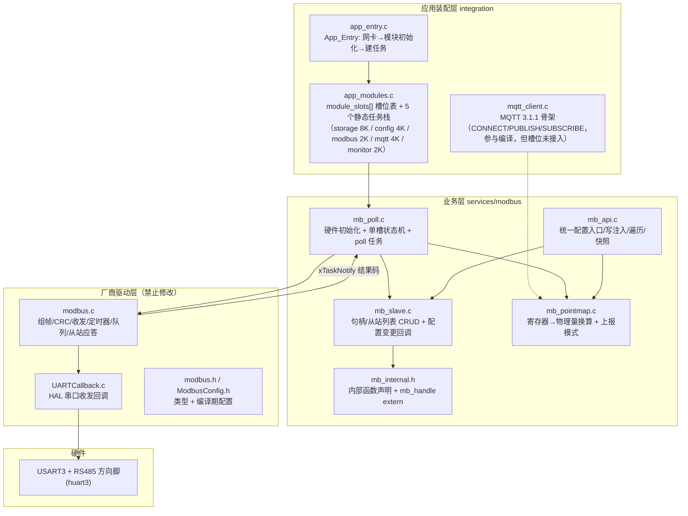
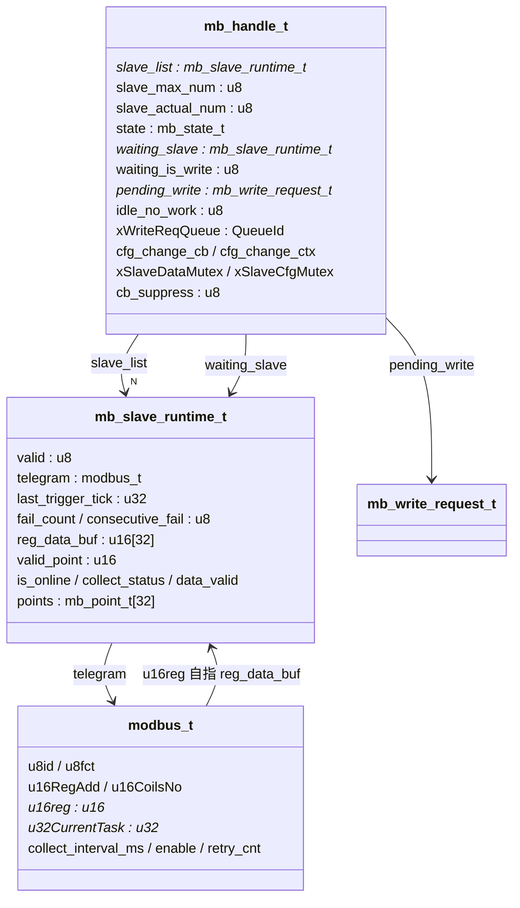
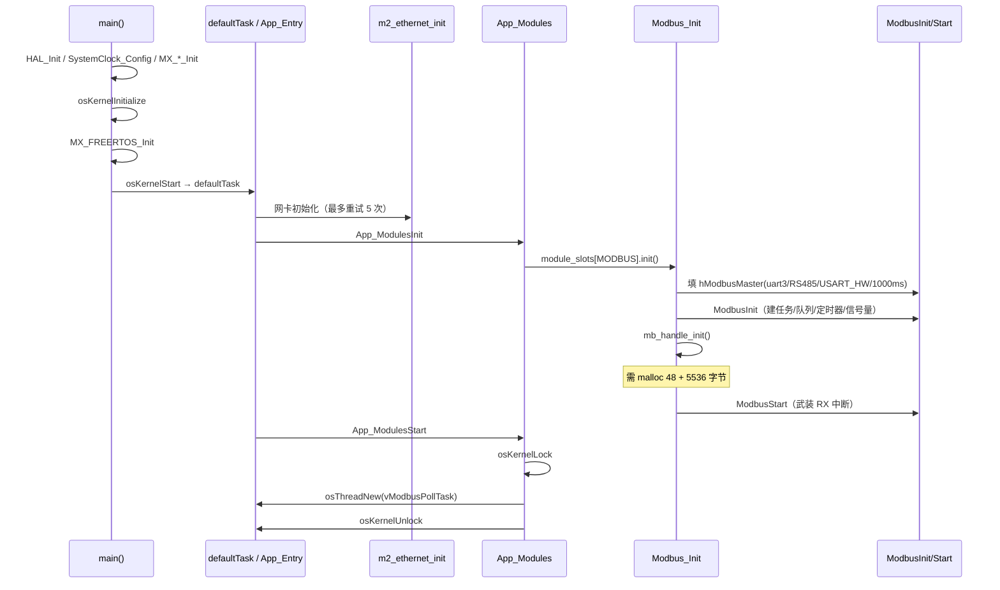
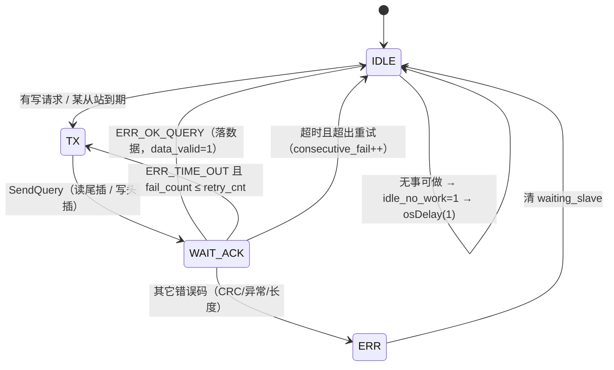
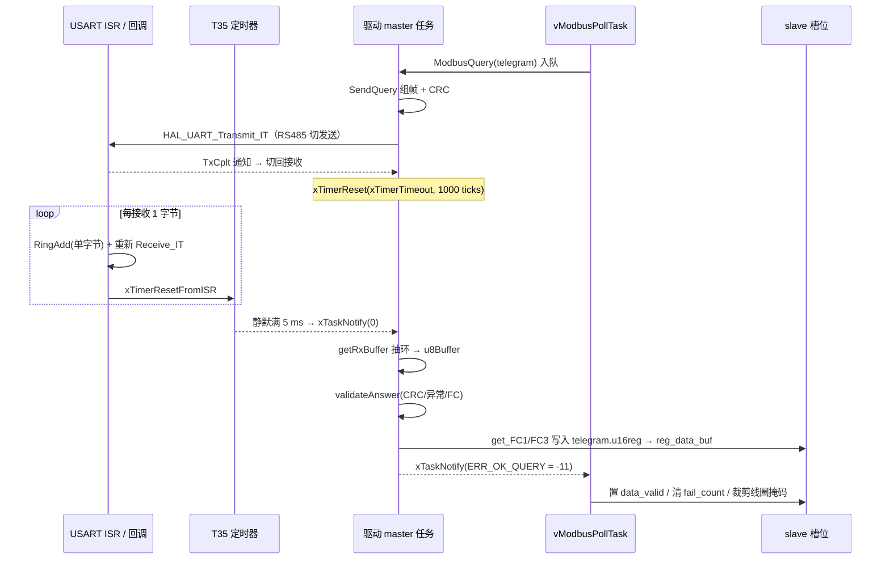
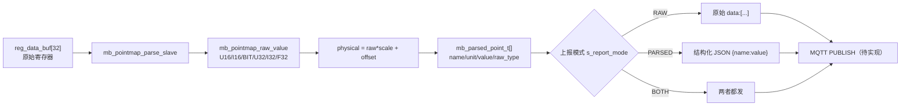
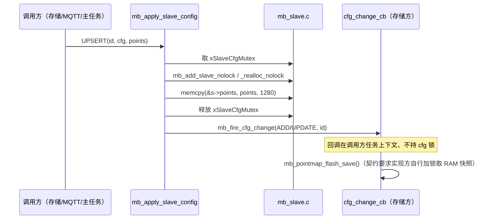

# Modbus RTU 主站模块说明书

> 适用工程：`modbus-mqtt-gateway`（STM32F407VET6 / 128 KB SRAM / 512 KB FLASH / FreeRTOS）
> 代码基线：分支 `modbus11-5`，HEAD = `bb17c11ff9483fc3b27a534f9b427aaed8c1bb60`（`bb17c11`），2026-11-06 实测 `git status`：所有跟踪文件无改动，只有 3 个未跟踪项 `build_nm.txt`、`firmware/app/services/modbus/modbus_test.c` 与本文档。曾经的裁剪提交 `d8eb7b0` 已从分支移除（`git rev-list` 显示它比 HEAD 多 1 个提交且不是 HEAD 的祖先），现在只由 tag `backup-d8eb7b0`（`d8eb7b0fd8ad8e5f1c5dbc06f3af53431c4e088f`）保存，分支上不存在该提交
> 构建口径：`build/Debug`（`cmake --preset Debug`，Ninja + arm-none-eabi-gcc 13.3.1，`-O0 -g3`），2026-11-06 基于当前工作区源码重新配置并全量重建；因跟踪文件无改动，工作区源码即 HEAD `bb17c11`，elf 反映的就是该提交，产物 `build/Debug/firmware/app/modbus-mqtt-gateway.elf` + `build/Debug/modbus-mqtt-gateway.map`
> 镜像类型：**全量镜像**——`services/storage`、`integration/mqtt_client.c`、FATFS/FatFs 全部参与编译，`main.c` 的 `MX_FATFS_Init()` 正常调用
> 已撤销方案：曾尝试剔除 storage/MQTT/FATFS 以腾出堆（当时测得堆 24,136 B、可挂 8 从站），该改动已从分支移除（见 tag `backup-d8eb7b0`），**当前代码不再具备该内存余量**，全文一律按全量镜像口径描述
> 数据来源：源码逐行核对 + 上述 elf（`nm -S`、`objdump -h`、`gdb ptype /o`）+ map 文件
> 本文档只描述现状，不代表修改建议；需要变更的项统一放在第 8 章"已知问题"。

---

## 0. 结论摘要（先看这 5 条）

| # | 结论 |
|---|---|
| 1 | 模块分三层：**厂商驱动层**（`modbus.c`/`UARTCallback.c`，负责组帧、CRC、收发、超时、通知）→ **业务层**（`mb_poll.c`/`mb_slave.c`/`mb_api.c`，负责调度、重试、缓存、CRUD）→ **消费层**（MQTT/存储，通过 `mb_pointmap.c` 与快照 API 取数）。 |
| 2 | 驱动层只做"一问一答"，**没有重试、没有周期**；周期采集、阶梯冷却、重试全部在 `mb_poll.c` 的 IDLE/TX/WAIT_ACK 状态机里。 |
| 3 | 数据是**零拷贝落地**：驱动把应答直接写进 `telegram.u16reg`，而该指针在注册从站时已被重指到 `mb_slave_runtime_t.reg_data_buf`（`mb_slave.c`）。 |
| 4 | 每个从站运行时结构 **1,384 B**，其中点位表 `points[32]` 占 **1,280 B（92.5%）**；从站列表是堆上连续数组，初始 4 槽、每次 +4、硬上限 16。 |
| 5 | **当前全量镜像的 newlib 堆只有 4,056 B**（`_end=0x2001EC28` → `_estack-1KB=0x2001FC00`），而初始 4 槽实际块 5,600 B → `mb_handle_init()` 第二次 `malloc` 必失败，`mb_handle` 保持 `NULL`，`vModbusPollTask`/`mb_poll_slave` 解引用即 HardFault。这是"加了节点也不生效/启动即崩"的首要嫌疑，详见第 7 章。 |

---

## 1. 分层架构



**分层边界（谁负责什么）**

| 环节 | 驱动层 `modbus.c` | 业务层 `mb_poll.c` / `mb_slave.c` |
|---|---|---|
| 初始化 | `ModbusInit` 建任务/队列/定时器/信号量；`ModbusStart` 武装 RX 中断 | `Modbus_Init` 填 `hModbusMaster`、调 `mb_handle_init`、再 `ModbusStart` |
| 组帧 | `SendQuery` 组 PDU，`sendTxBuffer` 追加 CRC、控 RS485 方向 | 只负责填 `modbus_t`（写请求在 `mb_poll_tx` 现场构造） |
| 排队 | `ModbusQuery` 尾插 / `ModbusQueryInject` 头插，深度 `MAX_TELEGRAMS=2` | 先查队列计数，再决定是否入队 |
| 周期/重试 | **无** | `mb_poll_idle` 判采集周期 + 阶梯冷却；`mb_poll_wait_ack` 按 `retry_cnt` 重发 |
| 超时 | `xTimerTimeout`（1000 ticks）→ 通知值 `-8` | 阻塞在 `ulTaskNotifyTake` 收结果 |
| 解析 | `validateAnswer`（CRC/异常/功能码）+ `get_FC1/FC3` 写入 `u16reg` | 置 `data_valid`、裁剪线圈掩码、更新 online/失败计数 |
| 持久化/回调 | **无** | `mb_fire_cfg_change` 单一回调出口 |

---

## 2. 文件清单

| 文件 | 行数量级 | 角色 | 是否可改 |
|---|---|---|---|
| `modbus.c` | 1,903 行 | Modbus RTU 主/从协议实现（第三方移植） | **禁止修改** |
| `modbus.h` | 293 行 | 驱动层类型与原型 | **禁止修改** |
| `ModbusConfig.h` | 42 行 | 驱动层编译期配置 | **禁止修改** |
| `UARTCallback.c` | 162 行 | HAL 串口收发回调 | **禁止修改** |
| `mb_api.h` | 约 340 行 | 业务层对外契约：枚举、结构体、API | 可改 |
| `mb_api.c` | 约 330 行 | 统一配置入口、写注入、遍历、快照 | 可改 |
| `mb_slave.c` | 约 280 行 | 句柄初始化、从站 CRUD、回调分发、批量模式 | 可改 |
| `mb_internal.h` | 约 40 行 | 内部函数声明、`mb_handle` extern | 可改 |
| `mb_poll.c` | 约 310 行 | 硬件初始化、poll 状态机、任务入口 | 可改 |
| `mb_pointmap.c/.h` | 约 216 / 137 行 | 点位表、类型换算、上报模式 | 可改 |
| `mb_pointmap_flash.h` | 50 行 | 持久化契约（只有声明，无实现） | 可改 |
| `modbus_test.c` | 约 376 行 | 测试用例（当前未被 CMake 收录） | 可改/可删 |

> **镜像编译范围**：`firmware/app/CMakeLists.txt` 含 `add_subdirectory(services/storage)`；`integration/CMakeLists.txt` 含 `mqtt_client.c`；`cmake/stm32cubemx/CMakeLists.txt` 含 `FATFS/App/fatfs.c`、`FATFS/Target/bsp_driver_sd.c`、`FATFS/Target/sd_diskio.c` 与 `FatFs` 库；`app_modules.c` 保留 storage/mqtt 任务栈与槽位；`main.c` 正常调用 `MX_FATFS_Init()`。第 7 章所有数字均基于该全量镜像。

---

## 3. 逐函数说明

### 3.1 驱动层 `modbus.c` / `modbus.h`

> 编译前提：`ENABLE_USB_CDC`、`ENABLE_TCP`、`ENABLE_USART_DMA` 均未定义（`ModbusConfig.h` 中被注释），因此 TCP / USB-CDC / DMA 三套代码不参与编译。实际链路是 **USART 逐字节中断接收**。

| 函数 | 行号 | 链接性 | 入参 / 返回 | 职责与关键逻辑 |
|---|---|---|---|---|
| `RingAdd` | 119-135 | 公开 | `ring*`, `uint8_t val` / void | 单字节入环；`u8available==MAX_BUFFER` 时置 `overflow` 并丢弃最旧字节 |
| `RingGetAllBytes` | 138-141 | 公开 | `ring*`, `buffer` / 字节数 | 转调 `RingGetNBytes(..., u8available)` |
| `RingGetNBytes` | 144-160 | 公开 | `ring*`, `buffer`, `n` / 实际读出数 | 从 start 拷出；**末尾调用 `RingClear`，剩余字节一并丢弃** |
| `RingCountBytes` | 162-165 | 公开 | `ring*` / `uint8_t` | 返回 `u8available` |
| `RingClear` | 167-173 | 公开 | `ring*` / void | start/end/available/overflow 清零 |
| `ModbusInit` | 200-305 | 公开 | `modbusHandler_t*` / void | 注册句柄、建内部任务（Normal，栈 512 B）、T35 定时器、超时定时器（仅 master）、信号量、telegram 队列（深度 2×24 B）；失败 `while(1)`；上限 `MAX_M_HANDLERS=2` |
| `ModbusStart` | 318-425 | 公开 | `modH*` / void | 校验硬件类型；RS485 切回接收；等 UART READY；`HAL_UART_Receive_IT(&dataRX,1)` 武装首字节；master 必须 `u8id==0` |
| `vTimerCallbackT35` | 444-461 | static | `TimerHandle_t*` / void | 帧结束节拍：master 先停超时定时器，再 `xTaskNotify(task, 0, eSetValueWithOverwrite)` |
| `vTimerCallbackTimeout` | 463-477 | static | 同上 / void | `xTaskNotify(task, ERR_TIME_OUT(-8))` |
| `SendQuery` | 815-920 | static | `modH*`, `modbus_t` / int8_t | **唯一组帧处**：FC1-4 写 ID/FUNC/ADD/NB 共 6 字节；FC5 写 `FF00/0000`；FC6 写值；FC15/16 逐位/逐字展开；组完发送并置 `COM_WAITING` |
| `StartTaskModbusMaster` | 1026-1173 | 公开（内部创建） | `void*`（=`modH*`）/ 不返回 | 主状态机：取队列 → `SendQuery` → `ulTaskNotifyTake` → 0=应答/非0=超时 → `getRxBuffer` → `validateAnswer` → `get_FC1/FC3` → 通知请求方 `ERR_OK_QUERY(-11)` 或错误码 |
| `StartTaskModbusSlave` | 624-760 | 公开（内部创建） | `void*` / 不返回 | 从站应答路径（本项目未使用）：校验 ID/功能码/地址范围 → `process_FCx` → `sendTxBuffer` |
| `ModbusQuery` | 764-775 | 公开 | `modH*`, `modbus_t`（按值）/ void | 仅 master；写 `u32CurrentTask=osThreadGetId()`；`xQueueSendToBack(...,0)` **队列满静默丢弃** |
| `ModbusQueryInject` | 779-785 | 公开 | 同上 / void | **先 `xQueueReset` 清空整队，再头插**；会丢掉尚未发送的读请求 |
| `get_FC1` | 1181-1198 | static | `modH*` / void | FC1/FC2 应答解析：按字节偏移 3 起拼 16 位字，写入 `u16reg`（无 `get_FC2`） |
| `get_FC3` | 1206-1216 | static | `modH*` / void | FC3/FC4 应答解析：逐寄存器写 `u16reg`（无 `get_FC4`） |
| `validateAnswer` | 1227-1272 | static | `modH*` / uint8_t | CRC → 异常位（`FUNC&0x80`）→ 功能码白名单 `fctsupported[]`；**不校验从站 ID，也不校验字节数与请求是否匹配** |
| `getRxBuffer` | 1282-1310 | static | `modH*` / int16_t 帧长或 `-3` | USART：先 `AbortReceive_IT`，环溢出则清空返回 `-3`，否则 `RingGetAllBytes` 写入 `u8Buffer`；再重新武装 |
| `calcCRC` | 1446-1469 | 公开 | `uint8_t*`, len / uint16_t | 初值 `0xFFFF`、多项式 `0xA001`，返回字节序已交换 |
| `sendTxBuffer` | 1505-1656 | static | `modH*` / void | 追加 CRC → RS485 切发送 → `HAL_UART_Transmit_IT` → 等 TxCplt（250 ticks）→ 自旋等 TC → 切回接收 → master 复位超时定时器 |
| `process_FC1/3/5/6/15/16` | 1667-1898 | static | `modH*` / int8_t | 从站侧应答组帧（本项目只作 master，不走这些路径） |
| `buildException` / `validateRequest` | 1479 / 1323 | static | — | 从站侧异常帧与请求校验（本项目未使用） |

`modbus_t` 字段语义（`modbus.h:141-160`）：

| 字段 | 含义 | 驱动层是否使用 |
|---|---|---|
| `u8id` | 从站地址 1~247（0=广播） | 是（组帧/校验） |
| `u8fct` | 功能码 1/2/3/4/5/6/15/16 | 是 |
| `u16RegAdd` | 起始寄存器/线圈地址 | 是 |
| `u16CoilsNo` | 数量（线圈个数或寄存器个数） | 是 |
| `u16reg` | 结果缓冲区指针（**只写不读、不拷贝**） | 是 |
| `u32CurrentTask` | 结果通知目标，由 `ModbusQuery/Inject` 覆盖 | 是 |
| `collect_interval_ms` / `enable` / `retry_cnt` | 采集周期 / 使能 / 重试次数 | **否**，仅业务层用 |

### 3.2 `UARTCallback.c`（IT 模式，非 DMA）

**接收链**：

1. `ModbusStart` → `HAL_UART_Receive_IT(port, &dataRX, 1)` 武装首字节（`modbus.c:385`）。
2. 字节到达 → `HAL_UART_RxCpltCallback`（`UARTCallback.c:60-90`）：遍历 `mHandlers[0..numberHandlers)` 按 `port` 匹配 → `RingAdd(&xBufferRX, dataRX)`(:73) → 再次 `Receive_IT(...,1)`(:74) → `xTimerResetFromISR(xTimerT35)`(:75) → `portYIELD_FROM_ISR`。
3. 总线静默满 `T35=5 ticks=5 ms` → `vTimerCallbackT35` → 停超时定时器 → `xTaskNotify(masterTask, 0)`。
4. 驱动 master 任务醒来 → `getRxBuffer` 抽环 → `validateAnswer` → `get_FC1/FC3` 落数据 → `xTaskNotify(telegram.u32CurrentTask, ERR_OK_QUERY(-11))`。

**发送链**：

1. `sendTxBuffer` 追加 CRC → RS485 切发送 → `HAL_UART_Transmit_IT`。
2. `HAL_UART_TxCpltCallback`（`UARTCallback.c:24-48`）→ `xTaskNotifyFromISR(myTaskModbusAHandle, 0)` → `portYIELD_FROM_ISR`。
3. `sendTxBuffer` 内 `ulTaskNotifyTake(pdTRUE, 250)` 被唤醒 → 等 `USART_SR_TC` → 切回接收 → master 复位超时定时器。

**要点**：中断**不直接唤醒业务 poll 任务**，而是一条两级通知链 —— ISR/T35 → 驱动内部任务 → `xTaskNotify` → poll 任务。

### 3.3 `ModbusConfig.h`

| 宏 | 值 | 作用 |
|---|---|---|
| `ENABLE_USB_CDC` | 注释 | 不启用 |
| `ENABLE_TCP` | 注释 | 不启用（连带 `NUMBERTCPCONN`/`TCPAGINGCYCLES` 不定义） |
| `ENABLE_USART_DMA` | 注释 | 不启用；运行时若选 `USART_HW_DMA` 会 `while(1)` |
| `T35` | 5 ticks | 帧结束检测（1000 Hz 下 = 5 ms） |
| `MAX_BUFFER` | 128 | 单帧最大字节数 = `u8Buffer` / 环形缓冲长度 |
| `TIMEOUT_MODBUS` | 1000 ticks | 主站应答超时 = 1 s |
| `MAX_M_HANDLERS` | 2 | 并发句柄上限（工程只用 1 个 master） |
| `MAX_TELEGRAMS` | 2 | telegram 队列深度 |

调试日志不在本文件：`MB_LOG_LEVEL` 与 `MB_LOGE/W/I/D` 定义在 `mb_api.h:16-52`，默认 `MB_LOG_LEVEL_INFO`，可编译期整体关闭。

### 3.4 `mb_api.h` / `mb_api.c`（对外契约 + 组合入口）

**公开 API**

| 函数 | 位置 | 入参 / 返回 | 职责 |
|---|---|---|---|
| `mb_apply_slave_config` | `mb_api.c:22` | `op`(UPSERT/DELETE)、`slave_id`、`cfg`(可 NULL)、`points`(可 NULL) / `mb_status_e` | 统一配置入口：一次持锁完成"建/改从站 + 覆盖点位表"，锁外只发一次回调 |
| `mb_inject_write` | `mb_api.c:103` | `slave_id`、`func_code`(5/6/15/16)、`reg_addr`、`reg_count`、`write_values`、`result_sem`、`result_err_out`、`result_timeout_ms` / `mb_status_e` | 组写请求 → 入 `xWriteReqQueue` → 可选同步等待结果 |
| `mb_for_each_valid_slave` | `mb_api.c:182` | `cb`、`ctx` / 遍历数量 | 持 cfg 锁遍历 `valid && enable` 的从站；回调非 0 提前停止 |
| `mb_take_slave_snapshot` | `mb_api.c:202` | `slave_id`、`snap_out` / `mb_status_e` | 两把锁分阶段：cfg 锁定位 → data 锁拷贝数据 |
| `mb_handle_get` | `mb_slave.c:32` | 无 / `mb_handle_t*` | 句柄访问器 |
| `mb_handle_init` | `mb_slave.c:40` | 无 / `mb_status_e` | `malloc` 句柄 + 从站数组 + 2 互斥量 + 1 队列（失败逐级回收） |
| `mb_realloc_slave_list` | `mb_slave.c:125` | 无 / `mb_status_e` | 公开加锁版扩容 |
| `mb_add_slave` / `mb_delete_slave` | `mb_slave.c:186/245` | `cfg*` / `slave_id` → `mb_status_e` | 加锁包装 + 锁外回调 |
| `mb_get_slave_runtime` | `mb_slave.c:89` | `slave_id` / `mb_slave_runtime_t*` | 线性扫描定位；**调用方必须已持 cfg 锁** |
| `mb_set_config_change_cb` | `mb_slave.c:99` | `cb`、`ctx` / void | 注册配置变更回调（不加锁） |
| `mb_notify_reload_complete` | `mb_slave.c:259` | 无 / void | 上电批量加载结束后发一次 `GLOBAL` |
| `mb_config_batch_begin/end` | `mb_slave.c:266/272` | 无 / void | 抑制中间回调；end 发一次 `GLOBAL` |
| `Modbus_Init` | `mb_poll.c:228` | 无 / **void** | 填 `hModbusMaster` → `ModbusInit` → `mb_handle_init`（**返回值被忽略**）→ `ModbusStart` |
| `vModbusPollTask` | `mb_poll.c:251` | `void*` / 不返回 | poll 任务入口，循环 `mb_poll_slave()` |
| `mb_poll_slave` | `mb_poll.c:268` | 无 / `mb_status_e`（恒 OK） | 状态机单步推进 |
| `mb_pointmap_*` | `mb_pointmap.c` | 见 3.6 | 点位读写/解析/上报模式 |

**公开加锁包装 ⇄ 内部无锁实现**（4 组）

| 公开版 | 内部版 | 锁 |
|---|---|---|
| `mb_add_slave` | `mb_add_slave_nolock` | `xSlaveCfgMutex` |
| `mb_delete_slave` | `mb_delete_slave_nolock` | `xSlaveCfgMutex` |
| `mb_realloc_slave_list` | `mb_realloc_slave_list_nolock` | `xSlaveCfgMutex` |
| `mb_pointmap_set_slave_points` | `mb_pointmap_set_slave_points_nolock` | `xSlaveCfgMutex` |

`mb_apply_slave_config` 自身是"组合层"：持锁后直接调 `_nolock` 版本，避免同锁重入；DELETE 分支例外，直接复用公开版 `mb_delete_slave`。

**枚举**

| 枚举 | 成员（值） |
|---|---|
| `mb_status_e` | `OK=0`、`INIT_STATUS_ERR=1`、`REALLOC_STATUS_ERR=2`、`HANDLE_STATUS_ERR=3`、`SLAVE_NOT_FOUND_ERR=4`、`PARSE_STATUS_ERR=5`、`BUILD_REQUEST_ERR=6`、`SEND_REQUEST_ERR=7`、`QUEUE_FULL_ERR=8`、`NOT_SUPPORT_FC_ERR=9`、`WAIT_TIMEOUT_ERR=10` |
| `mb_cfg_change_reason_t` | `ADD=0`、`UPDATE=1`、`DELETE=2`、`RELOAD=3`（**无触发点**）、`GLOBAL=4` |
| `mb_state_t` | `IDLE=0`、`TX=1`、`WAIT_ACK=2`、`ERR=3` |
| `mb_cfg_op_t` | `UPSERT=0`、`DELETE=1` |

### 3.5 `mb_slave.c`

| 函数 | 行号 | 关键逻辑 |
|---|---|---|
| `mb_handle_init` | 40-82 | `malloc(48)` 句柄 → `malloc(1384×4=5536)` 从站数组 → 清 0 → 2 个 `osMutexNew` → `osMessageQueueNew(4, 80)`；任一步失败按已建资源逐级回收；**`slave_list` 分配失败时只 `free(mb_handle)`，未置 `mb_handle=NULL`**（实为 `goto fail` 路径，两处不一致） |
| `mb_get_slave_runtime` | 89-97 | 线性扫描 `slave_max_num` 个槽，匹配 `valid && u8id` |
| `mb_realloc_slave_list_nolock` | 106-123 | 已达 `HARD_MAX=16` 直接返回 2；否则 `new_cap = max + 4`（4→8→12→16）；`realloc` 失败返回 2 且保留旧数组；成功后 `memset` 新增 4 槽 |
| `mb_add_slave_nolock` | 137-181 | 已存在：整体覆盖 `telegram`，再把 `u16reg` 重指 `reg_data_buf`、`u32CurrentTask=NULL`；不存在：**`slave_actual_num >= slave_max_num` 才扩容**（删除不缩容，有空洞时不会扩容），再找首个 `valid==0` 槽插入 |
| `mb_delete_slave_nolock` | 230-240 | 只置 `valid=0`、`actual_num--`；**不释放内存、不清点位表** |
| `mb_fire_cfg_change` | 22-28 | 唯一回调出口；`cb_suppress!=0` 或无回调时静默 |
| `mb_config_batch_begin/end` | 266-278 | 置/清 `cb_suppress`，end 发 `GLOBAL`；两者不持锁 |

### 3.6 `mb_pointmap.c` / `mb_pointmap.h`

| 函数 | 行号 | 关键逻辑 |
|---|---|---|
| `mb_pointmap_raw_value` | 31-72 | 单点位取值：`UINT16/INT16/BIT` 取 1 个寄存器；`UINT32/INT32/FLOAT32` 按大端 `(reg[i]<<16)|reg[i+1]` 拼 2 个寄存器；float 用 `memcpy` 规避严格别名；越界返回 0 |
| `mb_pointmap_set_slave_points_nolock` | 79-90 | 整表 `memcpy` 到 `s->points`（32 项） |
| `mb_pointmap_set_slave_points` | 95-110 | 加 cfg 锁 → `_nolock` → 锁外 `UPDATE` 回调 |
| `mb_pointmap_get_slave_points` | 112-147 | 加 cfg 锁定位 + 整表拷出，返回有效点位数量 |
| `mb_pointmap_parse_slave` | 150-205 | **先 cfg 锁定位，再释放、换 data 锁**读 `reg_data_buf + valid_point`；按 `physical = raw*scale + offset` 输出 `mb_parsed_point_t[]` |
| `mb_pointmap_set/get_report_mode` | 208-216 | 全局 `s_report_mode`（默认 `MB_REPORT_PARSED`）；set 时发 `GLOBAL` |

换算规则：`uint16/int16 → 1 reg`，`uint32/int32/float32 → 2 reg`，`bit → (reg[reg_index] >> bit_index) & 1`。

### 3.7 `mb_poll.c`（业务状态机）

| 函数 | 行号 | 关键逻辑 |
|---|---|---|
| `mb_get_backoff_cooling_ms` | 28-33 | 连续失败 1 次→5 s，2 次→10 s，≥3 次→20 s |
| `mb_poll_idle` | 40-80 | **先** 以 0 超时取 `xWriteReqQueue`（写优先）；**再** 线性扫描从站：跳过 `!valid/!enable`，跳过冷却期，跳过未到 `collect_interval_ms`，命中则记 `last_trigger_tick` 并转 TX |
| `mb_poll_tx` | 82-119 | 写路径：现场构造 `modbus_t`（`retry_cnt=0`）→ `ModbusQueryInject` 头插；读路径：先判 `osMessageQueueGetCount >= MAX_TELEGRAMS`，再 `ModbusQuery` 尾插 |
| `mb_poll_wait_ack` | 121-215 | `ulTaskNotifyTake(pdTRUE, portMAX_DELAY)`；写路径回填 `result_err_out` + `osSemaphoreRelease(result_sem)`；读路径按 `ERR_OK_QUERY / ERR_TIME_OUT / 其它` 三分支：成功置 `data_valid`、裁剪线圈掩码、清失败计数；超时按 `retry_cnt` 重进 TX，超限则 `consecutive_fail++` 并回 IDLE |
| `mb_poll_slave` | 268-298 | 按 `mb_handle->state` 调对应分支，维护 `idle_no_work` |
| `Modbus_Init` | 228-246 | 见 3.4；**未判空、未判返回值** |
| `vModbusPollTask` | 251-263 | `for(;;){ mb_poll_slave(); if (mb_handle->idle_no_work) osDelay(1); }` |

### 3.8 装配层

| 文件 | 关键点 |
|---|---|
| `app_entry.c` | `App_Entry` 在 `defaultTask` 上下文：`m2_ethernet_init()`（重试 5 次）→ `App_ReadinessInit()` → `App_ModulesInit()` → `App_ModulesStart()` → `osThreadExit()` |
| `app_modules.c` | `module_slots[APP_MODULE_COUNT]`；`APP_MODULE_STORAGE` 绑定 `Storage_Init` + `Storage_Task`，`APP_MODULE_MODBUS` 绑定 `Modbus_Init` + `vModbusPollTask`，`APP_MODULE_MQTT` 的 init/task 为 NULL（仅保留 `mqtt_attributes`，即 4 KB 栈已静态分配但任务未创建）；**5 个静态任务栈**：storage 8 KB / config 4 KB / modbus 2 KB / mqtt 4 KB / monitor 2 KB；`App_ModulesStart` 用 `osKernelLock` 包住 `osThreadNew` 循环 |
| `mqtt_client.c` | MQTT 3.1.1 **骨架**（参与编译但未接入槽位）：TCP 连接 → CONNECT → CONNACK → PUBLISH `online` → SUBSCRIBE `.../cmd` → 5 s 收超时计数满 5 次发 PINGREQ；收到 PUBLISH 只打日志，**未做 JSON 上报、未解析下行 payload** |

---

## 4. 结构体与生命周期

| 结构体 | sizeof | 存储位置 | 生命周期 |
|---|---:|---|---|
| `mb_handle_t` | **48 B** | 堆（`malloc`，`mb_handle_init`） | 进程级常驻，从不释放 |
| `mb_slave_runtime_t` | **1,384 B** | 堆（`slave_list` 连续数组，`malloc/realloc`） | 随句柄；删除只清 `valid`，元素永不单 free |
| `mb_point_t` | **40 B** | 内嵌于 `mb_slave_runtime_t` | 随槽位；删除后内容失效 |
| `modbus_t` | **24 B** | 内嵌于 runtime + telegram 队列（按值） | 入队/出队各一份值拷贝 |
| `mb_write_request_t` | **80 B** | 生产者栈 → 队列（按值）→ `s_pending_write`（`.bss`） | 一次写事务 |
| `mb_slave_snapshot_t` | **80 B（推算）** | 调用者栈 | 单次读取 |
| `mb_parsed_point_t` | **36 B（推算）** | 调用者栈 | 单次解析 |
| `modbusHandler_t`（`hModbusMaster`） | **324 B** | `.bss`（`mb_poll.c:17`） | 全局常驻 |
| `modbusRingBuffer_t`（在 `hModbusMaster.xBufferRX` 内） | 132 B | `.bss` | 全局常驻 |

**字段与引用关系**



**关键自指关系**：注册/更新从站时，`telegram.u16reg` 被强制改为 `&s->reg_data_buf[0]`，`u32CurrentTask` 清 NULL，`valid=1`。之后驱动 `get_FC1/get_FC3` 把应答直接写进 `reg_data_buf`，业务层零拷贝消费。

---

## 5. 主链路流程

### 5.1 上电初始化



### 5.2 poll 状态机



### 5.3 报文收发（一次读采集）



### 5.4 点位换算与上报



**现状**：`mb_pointmap_parse_slave` 已可用，JSON 组装与 PUBLISH 未实现（`mqtt_client.c` 只发 `status=online`）。MQTT 任务当前处于 `NULL` 槽位 / 未绑定 `MqttClient_Task`。

### 5.5 配置变更与持久化回调



---

## 6. 数据流转与锁的使用位置

**完整路径**

```
USART3 RX 中断（逐字节）
  → RingAdd(&hModbusMaster.xBufferRX)          [ISR，无锁，单生产者]
  → T35 静默 5ms → 驱动 master 任务
  → getRxBuffer: AbortReceive_IT → RingGetAllBytes → u8Buffer[128]
  → validateAnswer（CRC/异常/FC）
  → get_FC1/get_FC3 → 写入 telegram.u16reg
  → 实际落到 mb_slave_runtime_t.reg_data_buf[32]（零拷贝）
  → xTaskNotify(poll 任务, ERR_OK_QUERY)
  → mb_poll_wait_ack: 持 xSlaveDataMutex 更新 valid_point / data_valid
  → mb_take_slave_snapshot（cfg 锁定位 → data 锁拷贝）
  → mb_pointmap_parse_slave（cfg 锁定位 → data 锁解析）
  → mb_parsed_point_t[32]（调用方栈）
  → JSON 组装 → MQTT PUBLISH（待实现）
```

**锁矩阵**

| 锁 | 类型 | 保护对象 | 获取位置 | 释放位置 |
|---|---|---|---|---|
| `xSlaveCfgMutex` | `osMutex`（堆，ucHeap） | `slave_list` 指针、`slave_max_num/actual_num`、`telegram`、`points[]` | `mb_apply_slave_config`、`mb_add_slave`、`mb_delete_slave`、`mb_realloc_slave_list`、`mb_for_each_valid_slave`、`mb_take_slave_snapshot`（第一阶段）、`mb_pointmap_set/get/parse` | 各函数末尾；**回调在释放之后** |
| `xSlaveDataMutex` | `osMutex`（堆，ucHeap） | `reg_data_buf`、`valid_point`、`data_valid` | `mb_poll_wait_ack` 成功分支、`mb_take_slave_snapshot`（第二阶段）、`mb_pointmap_parse_slave`（第二阶段） | 对应结尾 |
| 驱动 `ModBusSphrHandle` | 二值信号量（当互斥用） | `u8Buffer` / `u16regs` 临界区 | `SendQuery`、`StartTaskModbusMaster` 解析段、从站 `process_FCx` | 对应结尾 |
| 无锁 | — | `xWriteReqQueue`、`mHandlers[]`、`numberHandlers`、`s_report_mode` | 依赖队列/单写者语义 | — |

**锁顺序规则（现状）**：任何路径都**不会同时持有** `xSlaveCfgMutex` 与 `xSlaveDataMutex`；`mb_pointmap_parse_slave` 与 `mb_take_slave_snapshot` 都是"先 cfg 后释放，再 data"，因此不存在嵌套死锁，但存在"定位后从站被删除"的逻辑窗口（数组不释放，只 `valid=0`，故不会野指针）。

---

## 7. 变量存储位置分析（重点）

> 本章数字来自**2026-11-06 全量重建的 elf**（构建目录 `build/Debug`，预设 `Debug`）：`nm -S` 取符号地址/大小，`objdump -h` 取分节汇总，`gdb ptype /o` 取结构体布局。map 文件 `build/Debug/modbus-mqtt-gateway.map` 同步核对。旧构建目录已删除，确保测的是当前源码编出的镜像。

### 7.1 内存分区真实数据

| 分区 / 符号 | 地址 | 大小 | 说明 |
|---|---|---|---|
| `_sdata` → `_edata`（.data） | `0x20000000` → `0x20000110` | **272 B** | 有初值的全局 |
| .bss 段 | `0x20000110` | **125,716 B** | 零初始化全局/静态；`_ebss=0x2001EC24` |
| `._user_heap_stack`（链接期预留） | `0x2001EC24` | 1,540 B | `_Min_Heap_Size(512) + _Min_Stack_Size(1,024) + 4 B 对齐`，仅作"堆/栈最小量"校验 |
| `_end` | `0x2001EC28` | — | newlib 堆起点 |
| `_estack` | `0x20020000` | — | RAM 顶 |
| MSP 预留 `_Min_Stack_Size` | — | **1,024 B** | 中断栈 |
| **newlib 可用堆** | `0x2001EC28` → `0x2001FC00` | **4,056 B** | `malloc/realloc` 唯一来源 |
| CCM（`.ccmram`） | `0x10000000` | **0 B** | 完全未使用 |
| RAM 合计（`.data`+`.bss`+预留+对齐） | — | **127,528 B** | 占 128 KB 的 **97.30%**（`size` 输出：text 176,728 / data 272 / bss 127,256） |
| FLASH 合计 | — | **177,008 B** | 占 512 KB 的 **33.76%** |

**`.bss` 主要占用者（全量镜像）**

| 符号 | 大小 | 归属 |
|---|---:|---|
| `memp_memory_PBUF_POOL_base` | 30,643 | LwIP pbuf 池 |
| `ucHeap` | 20,480 | FreeRTOS heap_4 |
| `ram_heap` | 16,403 | LwIP `MEM_SIZE` |
| `memp_memory_RX_POOL_base` | 15,683 | LwIP 收包池 |
| `storage_stack` | 8,192 | storage 任务栈（静态） |
| `config_stack` / `mqtt_stack` | 4,096 ×2 | 任务栈（静态） |
| `s_resp_buf` | 4,360 | storage 服务缓冲 |
| `memp_memory_TCP_SEG_base` | 3,003 | LwIP TCP 段池 |
| `modbus_stack` / `monitor_stack` / `defaultTaskBuffer` | 2,048 ×3 | 任务栈（静态） |
| `s_key` | 1,024 | storage 加密/密钥缓冲 |
| `hModbusMaster` | 324 | Modbus 主站句柄 |
| `s_pending_write.0` | 80 | poll 写请求缓冲 |
| `Idle_Stack.2` / `Timer_Stack.0` | 512 / 1,024 | FreeRTOS 内核任务栈 |
| 其余 LwIP memp（TCP_PCB/FRAG_PBUF/PBUF/NETCONN/…） | 约 1,900 | LwIP |

> 与已撤销的裁剪方案（.bss 105,660 B）相比，全量镜像多出 **20,056 B**：`storage_stack` 8,192 + `mqtt_stack` 4,096 + storage/FatFs/MQTT 静态对象（`s_resp_buf` 4,360、`s_key` 1,024 等）。LwIP 与 FreeRTOS 的静态占用未变化。

### 7.2 单个从站元素拆解（`sizeof = 1,384 B`）

| 字段 | 字节 | 占比 | 生命周期 |
|---|---:|---|---|
| `points[32]`（32 × 40） | **1,280** | **92.5%** | 随槽位常驻 |
| `reg_data_buf[32]` | 64 | 4.6% | 随槽位常驻 |
| `telegram`（`modbus_t`） | 24 | 1.7% | 随槽位常驻 |
| `valid / last_trigger_tick / fail_count / consecutive_fail / valid_point / is_online / collect_status / data_valid` + 对齐 | 16 | 1.2% | 随槽位常驻 |
| **合计** | **1,384** | 100% | |

补充：`mb_point_t` 自身 40 B = `reg_index(2) + data_type(2+2 pad) + scale(4) + offset(4) + name(16) + unit(8) + valid(1) + bit_index(1+2 pad)`。

### 7.3 与从站数无关的固定开销

| 项 | 请求字节 | 实际占用 | 来源 |
|---|---:|---|---|
| `mb_handle_t` | 48 | 56（+8 头） | newlib `malloc` |
| `xSlaveDataMutex` + `xSlaveCfgMutex` | — | 88 ×2 = 176 | **ucHeap** |
| `xWriteReqQueue`（4 × 80） | — | 80 + 4×80 = 400 | **ucHeap** |
| 驱动 telegram 队列（2 × 24） | — | 约 136 | **ucHeap** |
| 驱动信号量 / 2 个定时器 | — | 约 192 | **ucHeap** |
| `s_pending_write` | — | 80 | `.bss` |
| `hModbusMaster` | — | 324 | `.bss` |

即：newlib 侧固定 56 B；ucHeap 侧 Modbus 相关约 584 B。

### 7.4 扩容策略与瞬时峰值

`MB_SLAVE_INIT_CAP = 4`、`MB_SLAVE_HARD_MAX = 16`，每次 `+4` 槽，请求 `1,384 × new_cap`。

| 阶段 | 请求字节 | malloc 实际块 | realloc 瞬时峰值（旧块+新块+handle 56 B） | 对 4,056 B 堆的判定 |
|---|---:|---:|---:|---|
| 4 槽（初始化） | 5,536 | 5,544 | 5,544 + 56 = **5,600** | ❌ 超 1,544 B（首次分配即失败） |
| 8 槽 | 11,072 | 11,080 | 5,544 + 11,080 + 56 = **16,680** | ❌ 超 12,624 B |
| 12 槽 | 16,608 | 16,616 | 11,080 + 16,616 + 56 = **27,752** | ❌ 超 23,696 B |
| 16 槽 | 22,144 | 22,152 | 16,616 + 22,152 + 56 = **38,824** | ❌ 超 34,768 B |
| 32 槽（需改硬上限） | 44,288 | 44,296 | 22,152 + 44,296 + 56 = **66,504** | ❌ 稳态也要 44,352 B |

若被扩容的块正好位于堆顶（`slave_list` 之后没有其它 `malloc`），newlib 可原地 `sbrk` 扩展，峰值降为"仅新增部分"；否则按上表两倍计。当前 `mb_handle_t` 先于 `slave_list` 分配，`slave_list` 位于堆顶，理论上新块可通过 `sbrk` 顶到尾部，但 `realloc` 是否走该路径取决于 newlib 实现，**按最保守的两倍峰值评估容量**。注意：本镜像连 4 槽的 5,600 B 都放不下，扩容峰值讨论仅用于说明后续改造后的余量需求。

### 7.5 3 / 16 / 32 从站总占用

| 规模 | 实际槽位 | `mb_handle_t` | `slave_list` | 请求合计 | 实际块（含头） | 与 4,056 B 堆对比 |
|---|---:|---:|---:|---:|---:|---|
| 3 从站 | 4（初始即满） | 48 | 5,536 | **5,584** | **5,600** | ❌ **不足 1,544 B** |
| 8 从站 | 8（一次扩容） | 48 | 11,072 | **11,120** | **11,136** | ❌ 不足 7,080 B |
| 16 从站 | 16（每次 +4，共 3 次扩容） | 48 | 22,144 | **22,192** | **22,208** | ❌ 不足 18,152 B |
| 32 从站 | 32（须把 `HARD_MAX` 改到 ≥32） | 48 | 44,288 | **44,336** | **44,352** | ❌ 不足 40,296 B |

> malloc 开销依据：newlib `_malloc_r` 先 `(req+3)&~3` 再 `+8` 头，返回指针 `(chunk+11)&~7`（8 B 头 + 8 B 对齐）。从站数组是整块分配，因此只额外加 8 B。

### 7.6 容量结论

1. **当前全量镜像连 4 槽都建不起来**：`mb_handle_init` 需 `48 + 5,536 = 5,584 B`（实际块 5,600 B），而堆只有 **4,056 B**，缺 **1,544 B**。第二次 `malloc` 失败 → 返回 `MB_INIT_STATUS_ERR`；`Modbus_Init`（`mb_poll.c`，返回 `void`）忽略该错误 → `mb_handle == NULL` → `vModbusPollTask` 的 `mb_handle->idle_no_work` / `mb_poll_slave` 的 `mb_handle->state` 直接解引用空指针。
2. **曾验证的"剔除 storage/MQTT/FATFS"方案（已撤销）**：那次裁剪把 `.bss` 降到 105,660 B、堆升到 24,136 B，4 槽（5,600 B）与 8 槽（峰值 16,680 B）可跑，12 槽峰值 27,752 B 超限，故上限 8 从站。该改动已从 `modbus11-5` 移除（备份在 tag `backup-d8eb7b0`），**当前代码不具备这些余量，不能按 8 从站规划**。
3. **要在当前镜像跑 3 从站，至少腾出 1,544 B**。最省事的是降低点位数：`points[32]` 1,280 B/从站，若改为 8 点（320 B），单从站降到约 424 B，4 槽请求约 `48 + 4×424 = 1,744 B`，可在 4,056 B 堆内跑通。
4. **16 从站需 22,208 B、32 从站需 44,352 B**（32 还要把 `MB_SLAVE_HARD_MAX` 改到 ≥32），都要先解决堆容量。CCM 64 KB 全空（只能 CPU 访问），可搬 `ucHeap` 20,480 B 与静态任务栈；或减 LwIP `PBUF_POOL`（30.6 KB / `ram_heap` 16.4 KB / `RX_POOL` 15.7 KB）。
5. 上表是**静态预算**（按 newlib 请求 + 8 B 头推算），不含运行期其它 libc 分配；建议上电打印一次 `(_estack - 0x400) - _end` 与实际已用堆量做闭环确认。

---

## 8. 已知问题（按影响排序）

| # | 问题 | 位置 | 影响 |
|---|---|---|---|
| 1 | `MB_SLAVE_INIT_CAP=4` × 1,384 B（实际块 5,600 B）超过 4,056 B 堆，初始化必然失败 | `mb_api.h:12` + `mb_slave.c:48` | 启动即 HardFault（空指针），节点增删全部无效 |
| 2 | `Modbus_Init` 返回 `void` 且忽略 `mb_handle_init` 结果；`vModbusPollTask` / `mb_poll_slave` 不判空 | `mb_poll.c:228-298` | 内存不足时无任何提示直接崩，无回退路径 |
| 3 | `ModbusQueryInject` 先 `xQueueReset` 再头插 | `modbus.c:779-785` | 写请求会丢掉尚未发送的读请求 |
| 4 | `ModbusQuery` 队列满（0 超时）静默丢帧，函数返回 `void` | `modbus.c:764-775` | 上层无法感知丢帧 |
| 5 | `validateAnswer` 不校验从站 ID / 应答字节数 | `modbus.c:1227-1272` | 总线上其它从站的合法帧可能被当成应答写入 |
| 6 | 驱动 master 路径 `getRxBuffer` 返回值未判（USART 分支在 `#else` 里，`#if ENABLE_TCP/USB_CDC` 下的 1105 行不参与编译） | `modbus.c:1109` | 环形缓冲溢出被吞掉 |
| 7 | `mb_apply_slave_config` 退出时无条件 `cb_suppress=0` | `mb_api.c:82` | 会清掉 `batch_begin` 设置的抑制标志，批量模式中途调用即失效 |
| 8 | `MB_CFG_CHANGE_RELOAD` 无任何触发点；`notify_reload_complete` / `batch_end` 实发 `GLOBAL` | `mb_api.h:63`、`mb_slave.c:263/277` | 与注释语义不一致，存储方按 RELOAD 匹配会漏回调 |
| 9 | `mb_get_slave_runtime` 头文件公开但不加锁、不判空句柄 | `mb_slave.c:89` | 误用即竞态/空指针 |
| 10 | `mb_take_slave_snapshot` 不清零 `data[]` 尾部；定位与拷贝分两把锁 | `mb_api.c:202` | 残值泄漏 + 极限并发下读到"已删除从站"的旧数据 |
| 11 | `Modbus_Init` 只有一条 `MB_LOGE("Modbus初始化")`，无任何堆余量 / 初始化结果输出 | `mb_poll.c:230` | 无堆容量可观测性，初始化失败也无日志 |
| 12 | `modbus_test.c` 不在 CMake 源列表；其三个测试函数内的 `mb_point_t points1/2/3[32]`（各 1,280 B）是**函数内自动变量**，占用调用方栈而非 `.bss` | `modbus_test.c:57/89/125` | 当前不参与编译、不占 RAM；若启用并在 2 KB 的 modbus 任务栈里调用，单次调用就要 1,280 B 栈空间，有栈溢出风险 |

---

## 9. API 速查

| 场景 | 调用 |
|---|---|
| 新增/更新从站 + 点位 | `mb_apply_slave_config(MB_CFG_OP_UPSERT, id, &cfg, points)` |
| 删除从站 | `mb_apply_slave_config(MB_CFG_OP_DELETE, id, NULL, NULL)` |
| 批量加载（抑制中间回调） | `mb_config_batch_begin()` → 多次 UPSERT → `mb_config_batch_end()` |
| 读一个从站快照 | `mb_take_slave_snapshot(id, &snap)` |
| 读结构化物理量 | `mb_pointmap_parse_slave(id, parsed)` |
| 遍历在线从站 | `mb_for_each_valid_slave(cb, ctx)` |
| 下发写寄存器/线圈 | `mb_inject_write(id, FC, addr, n, values, sem, &err, timeout_ms)` |
| 注册持久化回调 | `mb_set_config_change_cb(cb, ctx)` |
| 切换上报模式 | `mb_pointmap_set_report_mode(MB_REPORT_PARSED)` |

**驱动层错误码（通知值）**

| 值 | 含义 |
|---|---|
| `-11` `ERR_OK_QUERY` | 应答成功 |
| `-8` `ERR_TIME_OUT` | 应答超时 |
| `-3` `ERR_BUFF_OVERFLOW` | 接收环溢出 |
| `-4` `ERR_BAD_CRC` | CRC 错 |
| `-5` `ERR_EXCEPTION` | 从站异常帧 |
| `-6` `ERR_BAD_SIZE` | 帧长非法 |

---

## 附录 A：本机可复现的数据获取命令

```powershell
# 结构体布局
& "D:/gcc-arm/arm-none-eabi/bin/arm-none-eabi-gdb.exe" -batch `
  -ex "ptype /o mb_slave_runtime_t" `
  "build/Debug/firmware/app/modbus-mqtt-gateway.elf"

# 各分区边界
& "D:/gcc-arm/arm-none-eabi/bin/arm-none-eabi-nm.exe" `
  "build/Debug/firmware/app/modbus-mqtt-gateway.elf" |
  Select-String "_sbss|_ebss|_end$|_estack|_sdata|_edata"

# .bss 大户排行
& "D:/gcc-arm/arm-none-eabi/bin/arm-none-eabi-nm.exe" --size-sort -S `
  "build/Debug/firmware/app/modbus-mqtt-gateway.elf"
```

按当前符号表复算堆容量（与第 7 章一致）：

```
heap = (_estack - _Min_Stack_Size) - _end
     = (0x20020000 - 0x400) - 0x2001EC28
     = 0xFD8
     = 4,056 B
```

复现本次重建（先删旧目录，确保测的是当前源码）：

```powershell
Remove-Item -Recurse -Force build\Debug
cmake --preset Debug
cmake --build --preset Debug
```
