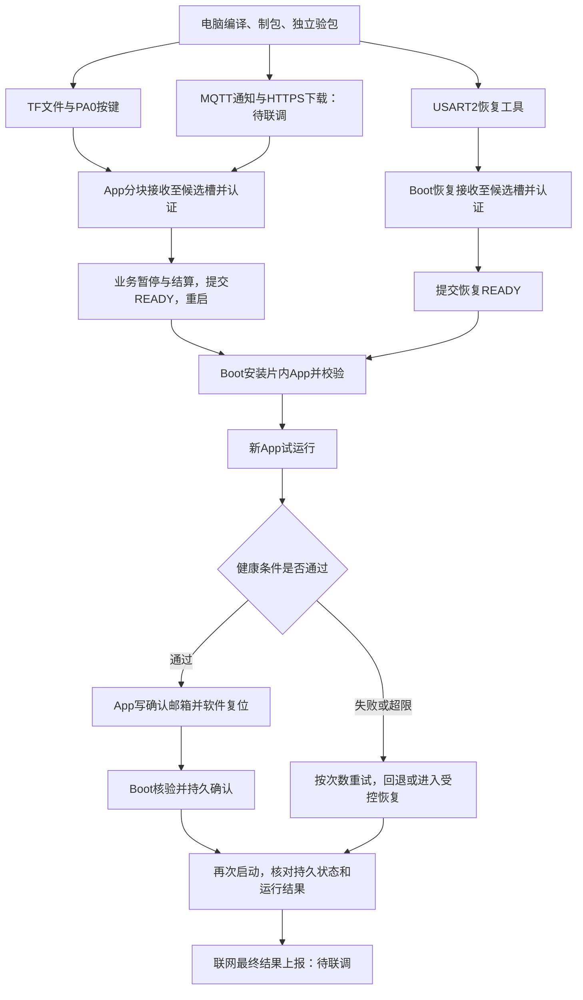

# 升级测试链路与验证记录

## 2026-11-16 补充：V133 单模拟从站自动复位修复

V132 在已导入一个从站配置后自行复位。首次监督失败现场为 Config 任务历史最低栈余量 244 B，低于 256 B 门槛；进展未超时、没有 fatal。随后在 Boot 清除复位标志前捕获 IWDG 复位，确认直接原因是栈余量不足导致监督停止喂狗，未发现实际栈越界证据。

V133 仅将原 CCM 中的 Config 栈从 1536 B 增至 2048 B，保留监督门槛和其他任务容量。相比冻结 V132，普通 SRAM 各段地址和大小不变；CCM 占用增加 512 B 至 64296 B，剩余 1240 B。片内 App 为 458048 B，剩余 704 B。

旧版自行复位中断了 TF 导入，因此本轮通过 USART2 正式恢复协议安装 V133；先查询受保护 B 槽，仅写 A 槽，收包认证通过后由 Boot 安装。V133 健康确认复位后，INFO 显示正常模式、无恢复会话、A 槽受保护，正式 RUN 应答成功。片内完整镜像与冻结 V133 一致，SHA-256 为 `730b871ffce20d21990c028b0b61260f308bbc762a4e405f5ca271c1f8f9b51d`。

复测负载为电脑模拟 RTU 从站 1、115200/8N1、FC03、地址 0 的一个寄存器，值 1234，采集周期 1000 ms、上报周期 5000 ms。13 次只读快照覆盖连续 120043 ms MCU 运行时间：Config 栈最低余 756 B，RTOS 堆最低余 5632 B，C 堆 arena 峰值 3136 B；监督健康、无 fatal、无故障寄存器置位或再次复位。TF 恢复 result=0/ready=1，MQTT 在线，日志持续读取 1234。遥测 queued 仅证明入队，未据此认定云端落库。

证据位于本机 `.local/tests/work/network-build-20261116/`：`v132-one-slave-first-failure.json`、`v133-build-check.json`、`v133-recovery-install.json`、`v133-one-slave-health.json`、`v133-recovery-uart1.log`、`v133-debug-close.json`。以上是原升级分组之外的单从站修复复测，不增加下文 15 组升级统计，不代表满容量或长期稳定性验收。实板使用本机 MQTT 凭据；仓库仅保留凭据占位符。

提交前基于 Gitee 主线 `467f9a3` 集成队友新增的 MQTT 从站配置入口和回执显示。首次链接 App 超出 Flash 11248 B；对 `config.c`、`mini_json.c`、`mqtt_client.c` 单独启用 `-Os` 后，AppDebug 构建通过，Flash 占用 458320 B、余 432 B，普通 SRAM 链接占用 108648 B（较冻结 V133 增 8 B），CCM 占用仍为 64296 B。BootSizeCheck 构建通过，Boot 镜像仍为 54868 B。此合并构建包含新主线功能和编译优化，与上述已实测的冻结 V133 不同；未烧录该合并构建，新增云端配置路径的动态内存峰值和运行行为仍待实板验证。

## 2026-11-16 补充：V131→V132 网络正常升级通过

实际链路为：签名 MQTT 通知 → 百度 BOS HTTPS 下载 → 外部 Flash 候选 B 槽 → 整包认证 → 业务暂停与结算 → READY → Boot 安装 → V132 试运行 → 健康确认复位 → Boot 持久确认 → MQTT 上报 confirmed 并收到 PUBACK。

- V132 加密包 458256 B，整包 SHA-256 为 `2158d6f3a80859f88414e81bd0db98a52ec2c64636c5bd0e02b32f26af5027e0`；BOS 回下载与本地一致。
- 板端 TLS 保持证书校验，实际协商 `TLS-ECDHE-RSA-WITH-AES-128-GCM-SHA256`，完整下载 458256 B；没有关闭认证或扩大本轮缓冲。
- Boot 安装后两次实际启动 V132；最终为 NORMAL、非试运行、sequence=25、tx=34、attempt=1。片内 458048 B 完整读回与冻结 V132 一致，镜像 SHA-256 为 `007b1360c24776e25408df3f544a4e3c3f5399519270a574afaf41f3d0beb09c`。
- `boot result PUBACK: tx=0000000000000022 phase=confirmed` 与板端事务一致。此证据到 broker 确认接收为止，不代表另一个云端业务系统已处理完成。
- 升级后 TF 恢复 `result=0 / ready=1`，配置已加载，MQTT 在线，无监督 fatal。此前同一内存布局的 V129→V131 已通过真实 PA0/TF 导入、认证、安装及健康确认。

| 本轮资源 | 实测或冻结布局 | 余量 / 口径 |
| --- | --- | --- |
| C 堆 | 升级峰值 17.92 KiB / 容量 22.34 KiB | 峰值下余 4.43 KiB；按分配器 arena 高水位统计 |
| FreeRTOS 堆 | 最低空闲 5.31 KiB | 总容量 24 KiB，已计入普通 SRAM 静态区 |
| 网络升级任务栈 | 最低空闲 2.26 KiB | 原 6 KiB 容量未增 |
| 普通 SRAM | mailbox 64 B + 静态 104.59 KiB + C 堆 22.34 KiB + MSP 1 KiB | 合计 128 KiB，静态区包含 FreeRTOS 堆 |
| CCM | 链接占用 62.29 KiB / 64 KiB | 余 1.71 KiB；DMA 缓冲仍在普通 SRAM |

本轮首次下载曾在 82296 B 返回接收超时，连接和候选会话正常清理，V131 保留运行。普通复位后用同一固件、同一包及同一通知定向复测完成上述闭环；没有命中接收失败断点，采样未见 RX 池分配失败。**首次接收停顿根因尚未定位，不能把重试成功写成已修复所有网络稳定性问题。** 之前 TLS 计算阶段超过 3 s 的监督问题已据现场将网络任务无进展期限改为 15 s，下载总期限和证书检查保持。

按原有分组，N02 完整 HTTPS 下载、N03 网络正常升级与 broker 回执已有实板通过证据；N01 已验证合法通知及错误目标、过期、坏签名拒绝，完整撤权等边界未全部覆盖。原 13 组加 N02/N03 共 **15 组已有对应通过记录**，旧组仍限原版本及原负载。N01 剩余边界、N04 异常矩阵、真实从站并发及长期测试不计已完成。用户明确本轮正常闭环通过即停止，不继续追加这些测试。TF 配置正常导入、保存、重启生效已有本轮记录，完整非法字段及互斥矩阵仍未覆盖。

14:35～14:44 按用户新要求再次完整复测：先以原 TF 包恢复 V131（tx=35），再使用相同 V132 包和仍有效的原通知。第一次下发在授权阶段被拒绝，未进入收包、未擦写候选槽；具体失败原因未捕获。一次针对授权返回码的复测中，返回 OK，UTC=1794811198 落在签名有效期内，随即移除断点并继续正常下载/认证/安装。最终 V132 为 NORMAL、sequence=33、tx=36、attempt=1、trial=false；片内完整读回一致，TF ready=1，MQTT 收到该事务的 confirmed PUBACK。C 堆峰值仍 18348 B，RTOS 最低空闲 5440 B，网络栈最低余 2316 B，没有生产源码改动。

本次追加结果是**再次完成一轮闭环，但发生过一次尚未定位的授权拒绝**，不能描述为连续两次无故障通过；前一轮的接收超时也仍保留。追加证据为同目录的 `network-full-v132-result-repeat-normal.json`（授权失败）、`v131-repeat-authorize-capture.json`、`network-full-v132-result-repeat-auth-capture.json`（闭环通过）、`v132-repeat-final-state.json` 和 `v132-repeat-uart1.log`。重复执行不新增统计组数；结束时板子运行已确认的 V132，串口与调试器已释放。

14:54～15:14 第三轮按用户要求复测：原 TF 包恢复 V131 后，已确认 NORMAL、sequence=37、tx=37、trial=false，完整镜像匹配。旧通知临近失效，用户仅重签 V132 通知，没有重制包或修改 BOS 文件。14:59:59 首次下发命中通知授权失败分支，实际 `authorized=8（AUTH）`、`utc=0`，候选会话仍为空、未进入 Begin；不是已捕获的 `E_MODE` 或 TRIAL 拒绝。证据：`v131-third-baseline-state.json`、`v131-third-auth-capture.json`、`network-full-v132-result-third-failure-capture.json`。

针对时间读取的复测先观察正常周期检查 55 s，未见失败；随后复用同一有效通知，15:10:12 在 Storage 任务的 RTC 状态读取失败分支捕获 `HAL_ERROR`、`HAL_I2C_ERROR_AF=0x04`（应答失败），I2C 互斥已取得，控制寄存器的一个字节尚未读完。该现场证明 RTC/I2C 链存在偶发读取失败；它与前一次授权 UTC=0 不是同一次调用，尚不能唯一确定底层电气原因或把全部历史授权失败归为同一原因。证据：`v131-rtc-failure-capture.json`、`v131-rtc-notification-capture.json`。

这次定向复测随后完整下载、认证并安装 V132，健康确认后再次启动，上报 `tx=0000000000000026 phase=confirmed` 并收到 PUBACK。最终 NORMAL、sequence=41、tx=38、attempt=1、trial=false，片内完整读回匹配，TF ready=1、配置加载、MQTT 在线，无 fatal。C 堆峰值 18348 B、RTOS 最低余 5440 B、网络升级栈最低余 2316 B。证据：`network-full-v132-result-third-rtc-capture.json`、`v132-third-final-state.json`、`v132-third-uart1.log`。没有新增生产代码或 SRAM 占用；断点已撤除、板子继续运行、串口与调试器已释放。正常闭环再次通过，RTC 偶发读取失败和先前接收超时仍保留为未解决项，不追加其他测试组。

关于拒绝阶段的区分：TRIAL 期间 `App_UpgradeCanCommit()` 确实禁止 Begin，但不能据此推断本次 AUTH 的根因。当前网络任务在 Begin 前先做通知有效期与签名校验，下载后 Finish 再认证升级包。确认由 App 健康判定、确认邮箱、复位及 Boot 持久确认完成，云端接收结果；不是云端把本地 trial 标志改为 false。连续升级工具应等待已确认基线，本轮工具已有 NORMAL 和镜像校验，上述基线证据也明确 trial=false。

证据位于本机 `.local/tests/work/network-build-20261116/`：`pair-131/packages.json`、`v132-bos-check.json`、`v131-tf-result.json`、`network-full-v132-result.json`（首次失败）、`network-full-v132-result-recv-capture.json`（正常闭环通过）、`v131-recv-capture.json`、`v132-final-state.json`、`v129-network-uart1.log`，以及各次追加记录。无真实 Modbus 从站；不据此宣称满负载、长期运行或整机验收通过。

**以下第 1～7 节保留 2026-11-15 的历史分组与测试过程；其中“当前”“剩余”的日期基准为 11 月 15 日，最新状态以上述补充为准。**

截至 2026-11-15，SPI3、W25Q64 和冻结 V121/V122 基线的升级验证归并为 **13 组：11 组实板验证、2 组电脑端验证**。串口恢复、TF 正常升级、已测错误输入、失败回退及四个关键阶段的断电恢复已有通过记录；当时网络升级闭环待验证。

本文供项目成员复盘和继续测试，说明每组测试怎样执行、依据什么判定、还缺什么。接线和资源详见[硬件与运行资源](hardware-resources.md)，接口、持久格式及恢复命令详见[升级说明](../firmware/app/services/upgrade/README.md)。

## 1 统计方式与当前结论

一组指一个完整验证目的，例如“串口恢复后完成健康确认”或“安装期间断电恢复”。同一流程中的重传、换包、按键、复位及诊断重试不重复计组。早期 SPI2 的失败排查放在末尾附录，不当作当前 SPI3 的通过记录。

| 范围 | 数量 | 说明 |
| --- | --- | --- |
| 已完成的电脑端验证 | 2 组 | 测试包独立验证、共用认证代码正反用例 |
| 已完成的实板验证 | 11 组 | 1 组 SPI3 基础检查，加 10 组升级与恢复链路 |
| 上述组内四个脚本批次 | 86 个检查点 | 18＋14＋10＋44；是组内检查，不与 13 组相加 |
| 升级链路剩余 | 4 组 | 通知授权、HTTPS 下载、网络正常升级、网络异常恢复 |
| 升级以外的整机收尾 | 另 3 类 | TF 配置、真实业务并发及控制、长期与整机数据一致性 |

13 组是本次按目的整理的核心验证清单，不是项目历次构建、静态分析、调试操作或所有脚本断言的累计次数。“剩余 4 组”也不表示只需操作四次即可完成整机验收；部分测试仍依赖实际云端约定和软件接入。

## 2 测试环境与版本

| 项目 | 本次条件 |
| --- | --- |
| MCU / 存储 | STM32F407，外接 W25Q64，8 MiB |
| Flash 总线 | SPI3，Mode 0，分频 8；按 APB1=42 MHz 计算为 5.25 MHz |
| Flash 信号 | CLK→SWO/PB3，DO→PB4，DI→PB5，CS→PD11；3.3 V、共地；PB4/PB5 无编码器或 LCD 外接设备 |
| 日志 | USART1，PA9/PA10；本轮 COM6，由采集工具占用 |
| 恢复维护 | USART2，PD5/TX、PD6/RX，115200、8N1；本轮 COM7，转串口共地、3.3 V 电平 |
| 调试 | DAPLink / OpenOCD；用于只读核对、捕获故障或将程序停在明确的断电位置 |
| TF 触发 | 根目录 `/firmware.gwp`；PA0 长按至少 3 s，再松开；测试升级时不得同时存在 `/config.json` |
| Boot 冻结镜像 | `D:/GatewayReleases/TestBoard01/V121/boot-spi3-div8.elf` |
| App 冻结镜像 | `D:/GatewayReleases/TestBoard01/V121/app-v121.elf`、`V122/app-v122.elf` |
| 包版本 | V121、V122，各 453160 B；包封装及持久兼容号均为 2 |
| 网络负载 | 本轮完整 SPI3 离线验证时网口 link DOWN，无真实从站并发负载证据 |

V121 包 SHA-256：`43a2ef62e04ad059336269234a5d24a7a423f56ccb5b0a66022a298839e281c0`。

V122 包 SHA-256：`4df80186381aaf1eb8bf62deadc848493915e27f6d1211db37498d9253800068`。

V121→V122 正常升级结束时 A/V122 受保护、B/V121 保留；后续恢复用例会改变槽角色。2026-11-15 最后一组测试结束时为 **B/V122 已确认，A/V122 保留**。复测前必须重新查询保护槽，不能照抄历史 A/B 选择。

当前目录整理后的 App 构建为 452896 B，板上冻结 App 为 452952 B；新构建尚未烧录。诊断地址和断点必须与实际镜像匹配。桌面 V101 仅保留作 BOS 下载测试对象，不能用于当前 SPI3 安装验证。

## 3 升级链路全貌

外部 A/B 槽存放加密包，运行程序位于一份片内 App 区域。TF 与网络由 App 接收；维护串口由 Boot 接收。各入口最终都要经过认证、持久状态、安装、试运行和确认。

判断成功时按下表逐层核对，不能只看一条“成功”打印。

| 观察到的结果 | 已证明的阶段 | 仍需核对 |
| --- | --- | --- |
| 电脑制包自检通过 | 该文件能通过电脑侧验证 | 设备是否收到、是否接受 |
| 最后一个数据块已确认 | 收包已推进到声明长度 | 整包认证及安装 |
| READY / REBOOT_PENDING | 候选已认证并提交待安装状态 | Boot 实际安装及试运行 |
| Install result=1 / TRIAL | 安装路径完成并登记试运行 | 实际启动、App 健康及持久确认 |
| 出现 V122 启动日志 | 程序运行到该打印位置 | 模块健康和确认结果 |
| 匹配本次事务的已确认状态，复位后仍保留 | 本轮升级确认闭环完成 | 长期稳定性、业务和网络回执 |

## 4 已完成的 13 组测试

证据链接指向本机 `.local/tests/logs/`，该目录不随 Git 分发；对外交付时需另行提供选定证据。表中“通过”仅覆盖对应条件。

| 编号 | 测试组 | 类型 | 通过依据与证据 |
| --- | --- | --- | --- |
| T01 | V121/V122 包独立验证 | 电脑 | ECDSA 验签、AES-GCM 解密、冻结固件逐字节比对及现有信任匹配；[记录](../.local/tests/logs/w25q64-spi3-v121-v122-packages-20261114.json) |
| T02 | SPI3 基础读写 | 实板 | 整包读取分段校验、保留扇区跨页写后比对及最终擦空；[记录](../.local/tests/logs/w25q64-spi3-analysis-20261114.json) |
| T03 | USART2 合法恢复与健康确认 | 实板 | V121 正式接收、安装、片内读回、启动、确认及再次复位；[记录](../.local/tests/logs/w25q64-spi3-v121-baseline-20261114.json) |
| T04 | PA0 触发 TF 正常升级 | 实板 | V121→V122，接收、认证、READY、安装、确认和再次启动；[记录](../.local/tests/logs/w25q64-spi3-v122-tf-result-20261114.json) |
| T05 | 恢复协议错误输入及合法重试 | 实板 | 18 个检查点通过，坏签名拒绝后合法恢复完成；[记录](../.local/tests/logs/spi3-recovery-negative-20261114.json) |
| T06 | 恢复接收超时与软件复位 | 实板 | 14 个检查点通过，重复块不续期、屏障保留、旧会话拒绝及合法恢复；[记录](../.local/tests/logs/spi3-recovery-timeout-20261115.json) |
| T07 | TF 坏签名拒绝与清理 | 实板 | AUTH 拒绝、清理回 IDLE、未安装、原已确认槽保留并再启动；[记录](../.local/tests/logs/tf-bad-signature-confirm-20261115.json) |
| T08 | 两次试运行失败与看门狗回退 | 实板 | 两次真实 IWDG 复位后恢复保护槽，持久结果为 ROLLED_BACK；[记录](../.local/tests/logs/spi3-trial-watchdog-20261115.json) |
| T09 | 安装阶段断电恢复 | 实板 | App 已擦完、未首次编程时断电，复电重装并健康确认；[记录](../.local/tests/logs/spi3-install-powercut-20261115.json) |
| T10 | 首次试运行确认前断电 | 实板 | 复电后放行次数由 1 增至 2，随后健康确认；[记录](../.local/tests/logs/spi3-trial-powercut-20261115.json) |
| T11 | TF 部分收包时断电 | 实板 | 仅接收 1016 B 后断电，复电仍启动原版本，没有安装半包；[记录](../.local/tests/logs/spi3-tf-receive-powercut-20261115.json) |
| T12 | Boot 恢复部分收包时断电 | 实板 | 10 个检查点记录，复电保留恢复屏障，旧会话拒绝，新会话合法恢复完成；[记录](../.local/tests/logs/spi3-recovery-powercut-20261115.json) |
| T13 | 共用包认证正反用例 | 电脑 | 当前共用认证 C 代码与真实 mbedTLS，44 项通过；[记录](../.local/tests/logs/shared-package-negative-20261115.json) |

构建、静态分析、早期软件修复检查用于支持上述验证，不另凑成完整升级通过次数。故障注入或脚本准备失败也保留记录，不计为通过。

## 5 各组怎样执行及判断

### 5.1 电脑先验证测试输入 T01

1. 固定本轮 Boot、App 的 ELF/bin 及实际硬件配置，使用匹配的受控资料制包。
2. 重新读取生成包，独立核对签名，完成 AES-GCM 解密和认证。
3. 将解密后的 App 与冻结 bin 逐字节比较，核对目标、版本、长度及设备信任资料匹配。
4. 保存包长、整包 SHA-256 和结果；V121/V122 均通过。nonce 与当时保留的历史包无重复，持续唯一性仍依赖原账本，不删除或重置账本。

通过条件是输入包与预定固件及信任关系一致。此时尚未证明任何板端接收或安装行为。

### 5.2 SPI3 基础检查 T02

1. 核对实际接线及片选，先读取 JEDEC ID 和已有 A 槽包；不先擦除业务或升级状态。
2. 在任务、中断暂停的 RAM 探针条件下，读取 453224 B 已有包，111 个分段 CRC 与电脑一致。
3. 仅在当时明确允许的末尾 4 KiB 保留区 `[0x7FF000,0x800000)` 做擦除及空白检查。
4. 使用原失败载荷做 8 次跨页写入，共 16 条页编程命令，逐块及整扇区比对。
5. 最后擦空并核对，恢复借用 RAM、外设和 CPU 上下文，目标恢复运行。

本组通过说明对应数据和探针条件下读写正确；正式任务负载由后续 T03/T04 验证。历史错误槽的三个字节仍存在，是 SPI2 留下的旧数据，不计为 SPI3 新写入失败。

### 5.3 USART2 串口恢复完整流程 T03

本组由电脑把完整加密包交给 Boot，Boot 自行安装，再由新 App 完成健康确认。DAPLink 用于首次部署和核对；恢复用例中的 App 安装走正式串口协议。

1. **先验证电脑上的包。** 完成 T01，确认发送的是与 SPI3 固件和设备信任匹配的 V121 包。
2. **进入 Boot，查询保护槽。** USART2 接恢复工具，USART1 单独采集日志；先通过 INFO 查询当前状态，只选择允许擦写的候选槽。本轮恢复目标为 B，槽号不能作为以后测试的固定值。
3. **通过串口发送完整包。** Boot 分块接收、写外部 Flash 并读回；收齐后完成整包认证，通过才提交 READY。随后擦写片内 App，核对安装后的摘要及向量。
4. **启动新 App 试运行。** 核对实际 V121 启动、存储核心恢复和必要模块健康。App 满足健康条件后写确认邮箱，主动软件复位。
5. **Boot 处理确认。** Boot 核对确认消息对应的事务、序号、次数和镜像，重新认证源包并核对片内 App，再持久保存确认状态。
6. **再次复位并查状态。** 本轮 INFO 为 `normal=1 / recovery=0 / protected=2 / tx_state=1`；随后再次启动 V121，确认未退回未确认试运行或恢复阻断。

本组通过覆盖收包到持久确认，不能只用“串口发送完成”或版本打印替代。遇到超时先保留日志并查实际状态，不自动重发擦槽命令。

### 5.4 TF 按键升级完整流程 T04

1. **准备卡内文件。** 将已验证 V122 写为 `/firmware.gwp`，刷盘后读回，核对长度 453160 B 及整包 SHA-256；其他文件保留，根目录无 `/config.json`。
2. **确认升级前基线。** V121 已健康确认，TF ready=1；先记录保护槽和运行版本。
3. **真实按键触发。** 长按 PA0 至少 3 s，再松开一次。持续按住、插卡或启动本身不作为升级触发。
4. **App 导入并认证。** 第一遍读取 TF 计算整包摘要，第二遍分块写候选槽并读回；随后从持久包验证传输摘要、签名、GCM、明文摘要和向量。
5. **暂停业务并提交。** 模块暂停、在途结算及同步完成后提交 READY；本轮返回 `result=0 / REBOOT_PENDING / close=0 / abort=0`，然后自动复位。
6. **Boot 安装，新 App 确认。** Boot 安装及片内校验成功，实际 V122 启动；App 健康确认触发复位，Boot 保存确认状态。
7. **复查持久结果。** 本轮 INFO 为 `normal=1 / recovery=0 / protected=1 / source=0 / tx_state=1`；再次运行 V122，TF 恢复 ready=1。

这组证明了一次 V121→V122 正常升级。V121/V122 的 App 仅版本标记存在差异，因此它证明升级机制和版本切换，不代表业务数据格式跨版本兼容已经验证。

本轮 TF 结束时 C 堆峰值 6040 B、FreeRTOS 最低空闲 5824 B、TF 任务最低栈余 2332 B；这些数值属于该离线负载，不是 TLS 握手峰值。

### 5.5 串口错误请求与超时 T05 T06

两组都先查询已确认保护槽，再只操作另一个候选槽；每个批次最后用原合法包完成恢复和健康确认。

T05 的 18 个检查点如下：

| 序号 | 检查内容 |
| --- | --- |
| 1～7 | 初始状态；保护槽拒绝；非法槽号拒绝；过短包长拒绝；未知字段拒绝；无会话 FINISH 拒绝；这些拒绝后持久状态不变 |
| 8～14 | 并发 BEGIN 拒绝；错误会话拒绝；跳跃偏移拒绝；未收齐 FINISH 拒绝；相同重复块不推进偏移；不同内容重复块拒绝；相同 BEGIN 重放保留已收数据 |
| 15～18 | 坏签名拒绝；坏包未 READY、未安装；合法包可重新恢复；恢复后健康确认 |

T06 的 14 个检查点如下：

| 序号 | 检查内容 |
| --- | --- |
| 1～6 | 原 B 槽确认；部分收包；重复块和 INFO 不延长无进展期限；过期 CHUNK 拒绝；过期 FINISH 拒绝；过期 BEGIN 重放拒绝 |
| 7～11 | 软件复位后恢复屏障保留、RAM 偏移清零；旧会话拒绝；半包恢复保持 Boot；新会话编号不复用；旧会话不能写新事务 |
| 12～14 | 合法重试安装并校验；恢复 A 槽健康确认；再次启动及 TF ready |

T06 使用 `NVIC_SystemReset` 软件复位，没有物理断电。真正断电由 T12 单独验证。

### 5.6 TF 坏签名拒绝 T07

1. 从合法 V122 复制测试输入，仅将包偏移 128 的签名字节翻转一位；保留合法原包，电脑先确认坏签名被拒绝。
2. 将坏包写为 TF 的 `/firmware.gwp` 并读回一致，插回板子，用真实 PA0 长按释放触发。
3. 核对 App 返回 AUTH/result=8，清理回 IDLE，`close=0 / abort=0`；没有提交安装或运行坏包。
4. RESET 后查询，原已确认 A 槽仍受保护；再次运行 V122，存储与 TF 就绪。
5. 将 TF 固定文件恢复为合法 V122，并读回 SHA-256 一致。

本组只对坏签名做实板拒绝验证；电脑端的其他坏包类型不能直接记为实板已通过。

### 5.7 两次试运行失败和回退 T08

1. 保留已确认 A 槽，按正式 TF 流程导入候选 B。
2. 在候选 App 的 Monitor 入口通过调试器注入 RAM 致命故障标记，不修改发布包或永久健康条件。
3. 第一次停止喂狗后核对真实复位原因；Boot 记录第二次试运行机会，再次对候选注入同样故障。
4. 第二次失败后核对 `TRIAL attempt1 → attempt2 → RESTORING → CONFIRMED`，Boot 从原已确认槽恢复 App。
5. 核对候选清除、结果 ROLLED_BACK、片内镜像一致、原程序健康与 TF ready，撤掉诊断并恢复正常运行。

两次 IWDG 复位由主机观察约 33857 / 33911 ms；当前阶段已放宽原 8 s 目标。这组两槽均为 V122，证明槽与事务回退，不证明不同版本业务兼容；RAM 注入也不覆盖全部业务故障检测器。

### 5.8 四个真实断电位置 T09 至 T12

每次先让正式升级流程到达指定位置并保存状态，再由用户断开板子及 DAPLink、转串口等全部供电路径，确认指示灯熄灭至少 5 s 后复电。断电条件来自用户实际操作确认，没有示波器电源波形；串口句柄是否断开不单独作为断电证明。

| 组别 | 实际断电位置 | 复电后通过条件及实际结果 |
| --- | --- | --- |
| T09 安装 | INSTALLING 已提交，片内 App 扇区擦完，首次 256 B 编程未开始 | Boot 重新安装，片内镜像一致，App 健康确认并正常启动；通过 |
| T10 首次试运行 | 已登记 TRIAL/attempt1，新 App 尚未完成健康确认 | 复电按第 2 次机会试运行，随后确认；已安装镜像完整，无须重新擦写；通过 |
| T11 TF 收包 | 仅 1016 B 写入并读回，下一块未写、未提交 READY | 原确认状态保留，RAM 会话清零，不安装半包、不自动再次导入卡包，原 App 正常运行；通过 |
| T12 恢复收包 | Boot 恢复会话最后 ACK 为 4608 B；下一块未确认，最多可能写至 4864 B，未 FINISH | 恢复屏障保留，RAM 会话/偏移清零，旧会话拒绝并保持 Boot；新会话重传合法包，安装、健康确认及再次启动通过 |

T12 记录了 10 个检查点：原保护 A；准备会话过期后 A 仍保留；恢复屏障及首块受理；断电后屏障保留且 RAM 清零；旧会话拒绝；半包保持 Boot；新会话编号不复用；合法重试安装；B 健康确认并持久保存；再次启动及 TF ready。

T12 准备阶段曾因脚本把 `source` 字段期望值写错而停止。修正断言、确认原保护状态后重新开始，错误及当时现场保留在报告中；不是设备故障，也不另计一个通过用例。

这四组各覆盖一个受控断电点，不代表所有 Flash 编程、日志提交指令边界或整机业务随机断电矩阵均已覆盖。复测必须重新核对镜像、保护槽和断电位置，不直接套用旧断点地址。

### 5.9 共用认证代码正反用例 T13

使用当前 `upgrade_package.c` 与真实 mbedTLS 在电脑执行，密钥和输入仅在主机测试环境中生成，不改变设备资料。44 个检查点分布如下：

| 类别 | 数量 | 检查范围 |
| --- | --- | --- |
| 合法长度边界 | 8 | 明文 9、15、16、17、255、256、257、458752 B |
| 截断 | 2 | 小于封装开销、包体不足 |
| 包头和能力字段 | 16 | magic、封装版本、头长、硬件标识及填充、加载地址、明文/密文长度、密钥编号、持久版本、看门狗能力及保留字段 |
| 未重新签名的篡改 | 4 | 签名、摘要、密文、GCM tag |
| 错误可信密钥 | 2 | 错公钥、签名有效但 AES 密钥错误 |
| 签名有效的内容错误 | 3 | GCM tag、密文、明文摘要错误 |
| 认证后的非法向量 | 5 | 栈对齐、栈越界、栈落邮箱、缺 Thumb 位、入口超出镜像 |
| I/O、取消和期限 | 4 | 首读失败、后续读取失败、平台取消、总期限到期 |

44 项均通过。这组证明共用认证代码在主机条件下的接受/拒绝行为，不代替 MCU 密码耗时、硬件随机源、TLS 或实板所有坏包场景。

## 6 后续还剩哪些

### 6.1 升级主链还剩 4 组

下表是按现有缺口整理的剩余组别，不增加产品功能。必须先满足前置条件，再执行真实设备测试。

| 编号 | 待完成测试组 | 前置条件 | 完成标准 |
| --- | --- | --- | --- |
| N01 | MQTT 升级通知与授权 | M2/云端确定真实 topic、JSON、来源/目标/权限/有效期规则，绑定实际授权回调 | 合法通知进入唯一任务；非法来源、错误设备、过期或撤销任务被拒绝，不能凭包字段放行 |
| N02 | HTTPS 与 BOS 完整下载 | 网线连通、硬件 RNG、有效 UTC/时间下界、匹配 CA、实际 URL；先核对软件配置 | 证书校验开启，整包长度与 SHA-256 匹配，失败连接正确释放，记录握手/下载/释放的堆栈峰值 |
| N03 | 网络正常升级与最终回执 | N01/N02 通过，BOS 提供匹配当前 SPI3 的合法升级包，完成云端任务与事务关联 | MQTT→下载→认证→暂停→安装→健康确认→持久核对→真实最终结果上报闭环通过 |
| N04 | 网络异常与恢复 | 正常链路可运行，具备可控断网、超时、撤权及重试条件 | 收包中断、授权到期/撤销、任务重放等按既有规则拒绝或结算；无半包安装、无未知提交重写，恢复后可完成合法升级和结果上报 |

当前源码已在NetworkUpgrade_Init绑定真实签名核验：通知由package_upgrade.py --notification生成，检查本机目标、指定BOS HTTPS来源、UTC有效期和P-256签名，再授予本次许可；软件已接入，N01实板验证尚未完成。字段与签名步骤见[升级说明](../firmware/app/services/upgrade/README.md#签名通知与m2下发)。V101 可用于 N02 的文件传输验证，但不能作为 N03 的当前硬件安装候选；V122 目前仅有本地已验证包，上传后的地址、内容和任务条件需重新核对。

MQTT PUBACK 证明 broker 收到消息，不等于云端业务完成处理。N03/N04 的终态应与设备实际确认或回退状态对应，不能把 READY 当成安装成功。

### 6.2 整机验收另有 3 类

| 类别 | 尚未由本次升级测试证明的内容 |
| --- | --- |
| 配置链路 | TF 配置导入、字段拒绝、持久保存、手动重启生效，以及与升级暂停互斥 |
| 真实业务链路 | 实际 Modbus 从站采集、存储、MQTT 上报/补传与升级并发；完整控制持久执行仍需接入后验证 |
| 长期及数据一致性 | 按批准负载和时长运行、整机业务随机断电与数据一致性、不同业务版本兼容；不能由同版本槽回退或四个断电点替代 |

因此，按升级功能收尾看是 4 组；若问整个网关是否可以验收，还要关闭这 3 类。它们的具体子用例和持续时间按已有需求及实际接入情况确定，不能据分组数直接承诺剩余工时。

## 7 附录 SPI Flash 异常与处理记录

以下记录为什么从原 SPI2 迁移到当前 SPI3。原始报告按日期保留历史状态，较早章节里的“尚未接入/未通过”不代表今天的 SPI3 状态；详细材料见[Flash 读写异常排查报告](../.local/Flash读写异常排查报告-20261114.md)。

### 7.1 发生了什么及做过哪些对照

| 阶段 | 实际现象或测试 | 结果与解释 |
| --- | --- | --- |
| 原底板到货 | JEDEC 连续 16 次正确；5 个地址各读 256 B、重复 32 次，全为 FF | 只读 ID 和空白区通过，没有验证非空编程或正式升级负载；不能据此认定整个 Flash 可靠 |
| Boot 认证读取 | 包偏移 0xA2C0 曾读出 256 B 全 FF；发送占位字节改变会影响结果 | 固定发送 FF 后完整认证及部署后的验证通过；为什么原路径对占位数据敏感仍无唯一解释 |
| 应用复位 | 监督采样时间比模块最新进展早 1 ms，无符号差值误判超时 | V113 修复时间快照竞态；后续仍出现字节错误，所以它不是全部 Flash 故障的原因 |
| 原底板 V114 写入 | 已捕获 18 次编程地址、数据及拆页正确，11 个写前范围读回 FF；0x180A06 预期 0A，实际 02 | 写后校验发现真实差异，拒绝候选；HAL_OK 不证明芯片实际内容正确 |
| 独立读写与位置对照 | 暂停应用后独立写同一页仍失败；换地址及单字节写 08 曾通过 | 削弱纯应用并发解释，也不支持永久固定坏位的简单结论 |
| 降速与边沿对照 | 分频 64 仍失败，低 GPIO 速度局部通过，同一速度档也有通过/失败 | 小范围或低速通过不能当作修复；不能只靠反复降速下结论 |
| 外接 W25Q64 仍用 SPI2 | CS 改 PD11，CLK/DO/DI 直接接 PB10/PC2/PC3；分频 256 下 V120 仍写后不一致 | 并非只换芯片就解决；该接法不串行经过底板模拟开关，但原支路仍并联 |
| V120 针对性捕获 | 0x28945E～0x289460 预期 08 44 F6，读回 00 40 F4；PROGRAM 命令、地址和发送前后 RAM 正确 | 已缩小到实际擦写/传输/读回路径；该位置写前空白未捕获，没有芯片引脚波形 |
| 同一模块切 SPI3 | 5.25 MHz 基础读写通过；之后正式 V121 恢复、V121→V122 TF 升级通过 | 当前方案有实际流程证据；后续坏包、回退和断电用例继续通过，仍不能据此唯一定位旧 SPI2 根因 |

SPI2 的旧错误在换到 SPI3 后仍能被稳定读出，说明换线没有自动修复旧内容。这次读取旧数据不能记为 SPI3 又写错了。

### 7.2 排除了什么 还不能排除什么

| 可能原因 | 目前能作出的判断 |
| --- | --- |
| 测试包本身错误或 TF 写卡损坏 | 对有独立验包、写卡读回记录的那几份输入已排除；不能扩大为所有文件永久无误 |
| 上层交给 Flash 的数据错误、捕获点前后缓冲被改写 | 对已比对的事务已排除；RAM 正确不代表芯片引脚实际收到正确 |
| 未正确拆分 256 B 页边界 | 捕获的 18 次事务均符合边界，不能用这一解释对应错误 |
| 全部故障只是密码库误报 | 已在认证之外直接观察到字节差异，此解释不成立 |
| 只由任务并发或监督误判造成 | 独立 SPI 写入仍复现、监督修复后仍失败，不能作为唯一原因；不等于排除全部软件和外设影响 |
| 固定位永久损坏 | 相关位单字节写 08 能正确读回，与永久卡 0 的解释矛盾；间歇器件异常仍未排除 |
| 擦除不完整 | 部分轮次写前空白检查通过；V120 关键失败位置未捕获写前空白，不能全部排除 |
| SCK、MOSI、MISO、CS 的接触或信号质量 | 尚无引脚波形，仍属可能；上一块板 CLK 旁路成功是线索，不是本板结论 |
| 供电、地参考、焊接、器件模式或间歇芯片异常 | 仍缺同条件隔离对照或仪器证据，不能指定其中某一个为根因 |

### 7.3 当前处理结论

当前采用外接 W25Q64、SPI3/分频8，App 与 Boot 配置一致。写后读回、签名、GCM、安装校验和回退保护均保留，完整离线升级及已列故障测试通过。

原 SPI2 的具体电气或器件根因仍未唯一确定。若以后继续使用原底板 SPI2，应以保存的失败载荷和地址做同条件对照，并补芯片引脚信号/供电证据；已有通过记录不能直接迁回旧链路。当前 SPI3 的长期和真实业务并发仍按第6节验证。
